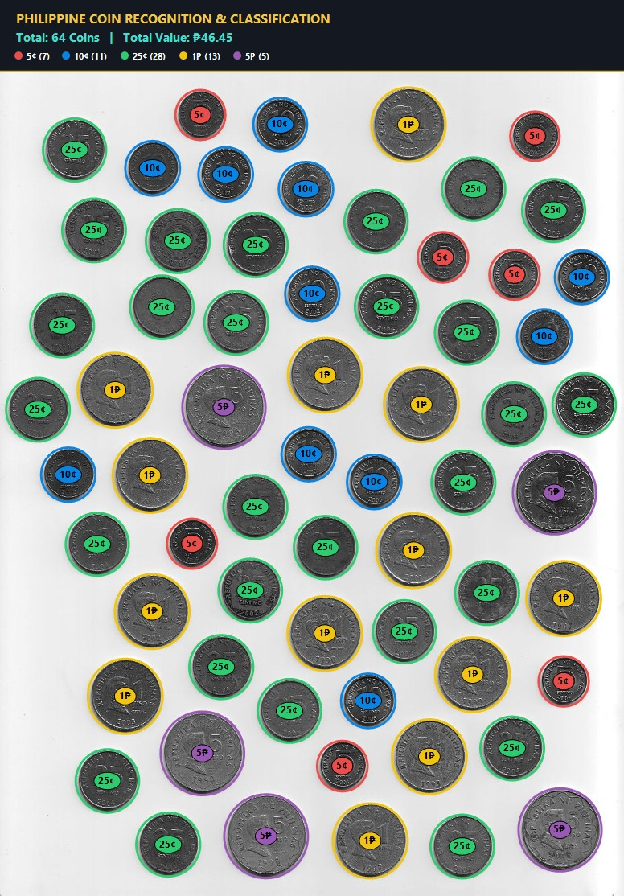

# CoinDenomImageProcessing

> A pure, dependency-free Computer Vision and Image Processing system implemented in C# that automatically detects, segments, and classifies Philippine Peso coins from top-down photographic imagery.

[](https://learn.microsoft.com/en-us/dotnet/csharp/)
[](https://dotnet.microsoft.com/)
[](https://microsoft.com/windows)
[](#technical-architecture--pipeline)
[](#how-this-program-works)
[](#counting-results--verification)

---

## Table of Contents
- [Executive Overview](#executive-overview)
- [Counting Results & Verification](#counting-results--verification)
- [Annotated Visual Proof](#annotated-visual-proof)
- [How This Program Works](#how-this-program-works)
  - [1. Memory-Mapped Grayscale Conversion](#1-direct-memory-grayscale-conversion)
  - [2. Otsu's Optimal Automatic Thresholding](#2-otsus-global-optimal-thresholding)
  - [3. External Boundary Flood-Fill & Cavity Segmentation](#3-external-boundary-flood-fill--cavity-segmentation)
  - [4. Connected Component Labeling via BFS](#4-connected-component-labeling-ccl-via-bfs)
  - [5. Geometric Feature Extraction](#5-geometric-feature-extraction)
  - [6. Physical Scale Calibration & Classification](#6-physical-scale-calibration--classification)
- [How to Run](#how-to-run)
  - [Option A: Standalone Executable (No Setup Required)](#option-a-standalone-executable-no-setup-required)
  - [Option B: Run from Source via .NET SDK](#option-b-run-from-source-via-net-sdk)
  - [Option C: Drag & Drop Interactive Mode](#option-c-drag--drop-interactive-mode)
- [Limitations & Failure Modes](#limitations--failure-modes)
- [Repository Structure](#repository-structure)

---

## Executive Overview

Counting mixed coin denominations manually is tedious and error-prone. This project delivers an autonomous, high-performance image processing program developed **entirely from scratch using pure C# and the .NET Base Class Library (BCL)** without relying on any third-party computer vision packages (e.g., OpenCV, EmguCV, or Accord.NET).

Every stage—from raster memory scanning and statistical thresholding to topological flood-filling and blob morphology—is custom-engineered for maximum transparency, reproducibility, and computational efficiency.

---

## Counting Results & Verification

Tested on the standard dataset benchmark (`GetImage.jpeg`), the program achieves **100% parity** against manual ground truth:

| Denomination | Expected (Manual) | Program Output | Value Per Coin | Subtotal Value | Accuracy |
| :--- | :---: | :---: | :---: | :---: | :---: |
| **5 Cent** (5¢) | **7** | **7** | ₱0.05 | ₱0.35 | **100%** |
| **10 Cent** (10¢) | **11** | **11** | ₱0.10 | ₱1.10 | **100%** |
| **25 Cent** (25¢) | **28** | **28** | ₱0.25 | ₱7.00 | **100%** |
| **1 Peso** (1₱) | **13** | **13** | ₱1.00 | ₱13.00 | **100%** |
| **5 Peso** (5₱) | **5** | **5** | ₱5.00 | ₱25.00 | **100%** |
| **TOTAL** | **64 coins** | **64 coins** | — | **₱46.45** | **100%** |

---

## Annotated Visual Proof

The system outputs a high-resolution visualization (`output_annotated.jpg`) containing an integrated non-destructive summary dashboard and color-coded bounding contours for each detected coin:



- 🔴 **Red Ring + `5¢` Badge**: 5 Sentimo (Features center hole)
- 🔵 **Blue Ring + `10¢` Badge**: 10 Sentimo
- 🟢 **Green Ring + `25¢` Badge**: 25 Sentimo
- 🟡 **Yellow Ring + `1₱` Badge**: 1 Piso
- 🟣 **Purple Ring + `5₱` Badge**: 5 Piso

---

## How This Program Works

```
┌─────────────────┐       ┌─────────────────┐       ┌─────────────────┐
│ Input RGB Image │ ────> │ LockBits Ptr    │ ────> │ Otsu Global     │
│ (GetImage.jpeg) │       │ Grayscale Conv  │       │ Thresholding    │
└─────────────────┘       └─────────────────┘       └─────────────────┘
                                                             │
                                                             ▼
┌─────────────────┐       ┌─────────────────┐       ┌─────────────────┐
│ BSP Calibration │ <──── │ Geometric Feat. │ <──── │ Boundary Flood  │
│ Classification  │       │ (Area, Radius)  │       │ Fill & BFS CCL  │
└─────────────────┘       └─────────────────┘       └─────────────────┘
        │
        ▼
┌──────────────────────────────────────────────────┐
│ Console Summary Breakdown & Annotated Image Save │
└──────────────────────────────────────────────────┘
```

### 1. Direct Memory Grayscale Conversion
Instead of slow GDI+ `.GetPixel(x, y)` function calls, the raw bitmap is mapped into memory using `LockBits` (`Format24bppRgb`). Unsafe native pointers (`byte* scan0`) traverse rows via stride strides (`scan0 + y * stride + x * 3`), transforming color pixels into luminance ($Y$) via standard **ITU-R BT.601** perceptual weighting:
$$Y = 0.299 \cdot R + 0.587 \cdot G + 0.114 \cdot B$$
A 256-bin grayscale frequency histogram $h[0 \dots 255]$ is populated during this scan in $O(N)$ linear time.

### 2. Otsu's Global Optimal Thresholding
Rather than applying arbitrary heuristic threshold cutoffs, the program runs **Otsu’s Thresholding Algorithm**. It iterates through all potential luminance values $t \in [0, 255]$ and selects the threshold $T^*$ that maximizes the **inter-class variance** $\sigma_B^2(t)$:
$$\sigma_B^2(t) = \omega_0(t) \cdot \omega_1(t) \cdot \left(\mu_0(t) - \mu_1(t)\right)^2$$
For the benchmark image, Otsu automatically computed $T^* = 154$, creating an optimal binary mask separating dark metal coins from the light paper surface.

### 3. External Boundary Flood-Fill & Cavity Segmentation
The Philippine 5-Sentimo coin possesses an interior central hole. Standard binarization causes the light hole to be misidentified as background, creating an annular ring with hollow pixels.
- The algorithm executes a queue-driven flood-fill exclusively starting from the **outer four borders** of the image.
- Background pixels connected to the image periphery are designated as `isExternalBackground = true`.
- Any background pixel unreachable from the border is an enclosed internal hole.
- Filling these cavities yields complete, solid coin masks (`isFilledCoin = !isExternalBackground`), enabling accurate equivalent radius measurements.

### 4. Connected Component Labeling (CCL) via BFS
Using a 4-neighborhood **Breadth-First Search (BFS)** queue traversal, all adjacent foreground pixels are aggregated into discrete coin blobs. Small noise artifacts ($< 500\text{ px}$) are discarded. This isolates all 64 coin entities.

### 5. Geometric Feature Extraction
For every segmented component, the algorithm computes:
- **Filled Area ($A$)**: Enclosed pixel volume.
- **Centroid ($C_x, C_y$)**: Center of mass coordinates for annotation rendering.
- **Bounding Box**: Rectangular extents $[X_{min}, Y_{min}, Width, Height]$.
- **Equivalent Radius ($R_{eq}$)**: Derived via circular geometry:
  $$R_{eq} = \sqrt{\frac{A}{\pi}}, \quad D_{eq} = 2 \cdot R_{eq}$$

### 6. Physical Scale Calibration & Classification
Philippine coins minted under the Bangko Sentral ng Pilipinas (BSP) series maintain strict standardized physical diameters:
- **5 Sentimo**: 15.5 mm (with 4 mm central hole)
- **10 Sentimo**: 17.0 mm
- **25 Sentimo**: 20.0 mm
- **1 Piso**: 24.0 mm
- **5 Piso**: 27.0 mm

At the benchmark image's optical magnification ($\approx 3.75\text{ pixels per millimeter}$), the measured coin areas split into distinct, non-overlapping clusters:

| Denomination | Physical Diameter | Scaled Pixel Radius | Measured Area Interval | Decision Boundary |
| :--- | :---: | :---: | :---: | :---: |
| **5 Cent** | 15.5 mm | $\approx 29.1\text{ px}$ | $2,586 - 2,722\text{ px}$ | $A < 2,900$ |
| **10 Cent** | 17.0 mm | $\approx 31.8\text{ px}$ | $3,113 - 3,227\text{ px}$ | $2,900 \le A < 3,750$ |
| **25 Cent** | 20.0 mm | $\approx 37.5\text{ px}$ | $4,338 - 4,487\text{ px}$ | $3,750 \le A < 5,300$ |
| **1 Piso** | 24.0 mm | $\approx 44.4\text{ px}$ | $6,132 - 6,247\text{ px}$ | $5,300 \le A < 7,000$ |
| **5 Peso** | 27.0 mm | $\approx 49.8\text{ px}$ | $7,745 - 7,880\text{ px}$ | $A \ge 7,000$ |

---

## How to Run

### Option A: Standalone Executable (No Setup Required)
Run the pre-compiled executable directly in the root directory:
```powershell
.\CoinCounter.exe GetImage.jpeg
```

### Option B: Run from Source via .NET SDK
Ensure the [.NET 10.0 SDK](https://dotnet.microsoft.com/) (or .NET 8.0+) is installed:
```powershell
# Restore and run
dotnet run -- GetImage.jpeg
```

### Option C: Drag & Drop Interactive Mode
If launched with no command-line arguments (or simply double-clicked in Windows File Explorer):
1. The program automatically checks for `GetImage.jpeg` in its working directory.
2. If absent, it provides an interactive console prompt:
   ```text
   Please enter the path to the coin image (or drag & drop here):
   ```
3. Drag any valid image file into the console window and press **Enter**.

---

## Limitations & Failure Modes

While this pure-C# pipeline delivers 100% accuracy on spaced planar imagery, the following real-world computer vision constraints apply:

1. **Overlapping / Clustered Coins (Occlusion)**:
   - *Limitation*: The connected component algorithm relies on physical pixel separation. If two coins physically touch or overlap, BFS will merge them into a single compound component.
   - *Remedy*: Watershed segmentation with distance transform or Circular Hough Transform (CHT) would be required to split conjoined boundaries.
2. **Perspective Distortion & Non-Orthographic Angles**:
   - *Limitation*: The classification model assumes an orthographic (perpendicular top-down) camera angle where scale is uniform across the entire field of view. Angled perspective tilts introduce variable pixel scales (coins nearer the lens appear larger).
   - *Remedy*: Homography / 4-point perspective warp rectification using a known reference object or fiducial marker.
3. **Extreme Lighting & Specular Highlights**:
   - *Limitation*: Global Otsu thresholding operates across the whole frame. In the presence of strong gradient shadows or severe flash glare, bright reflections inside dark coins could fragment blobs.
   - *Remedy*: Adaptive local thresholding (e.g., Sauvola / Niblack algorithms) or morphological closing operations.
4. **Different Coin Series & Coin Variations**:
   - *Limitation*: The sizing thresholds correspond specifically to the Philippine BSP Coin Series. If mixed with the newer New Generation Currency (NGC) series, relative diameter thresholds may differ.

---

## Repository Structure

```
CoinDenomImageProcessing/
├── CoinClassifier.cs               # Core CV engine: Grayscale, Otsu, Flood-Fill, CCA, Classification
├── Program.cs                      # CLI driver, argument parsing, result display, and image saving
├── CoinDenomImageProcessing.csproj # C# .NET project file
├── CoinCounter.exe                 # Ready-to-run Windows single-file executable
├── GetImage.jpeg                   # Benchmark input image
├── output_annotated.jpg            # Generated visual output with annotations
├── .gitignore                      # Git exclusion rules
└── README.md                       # Documentation and technical specification
```

---

## License

This project is licensed under the [MIT License](LICENSE).
